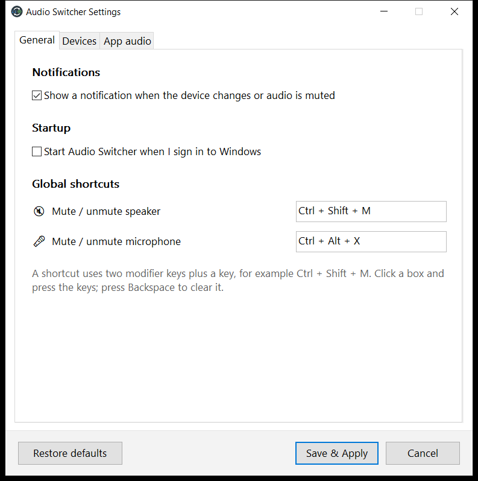
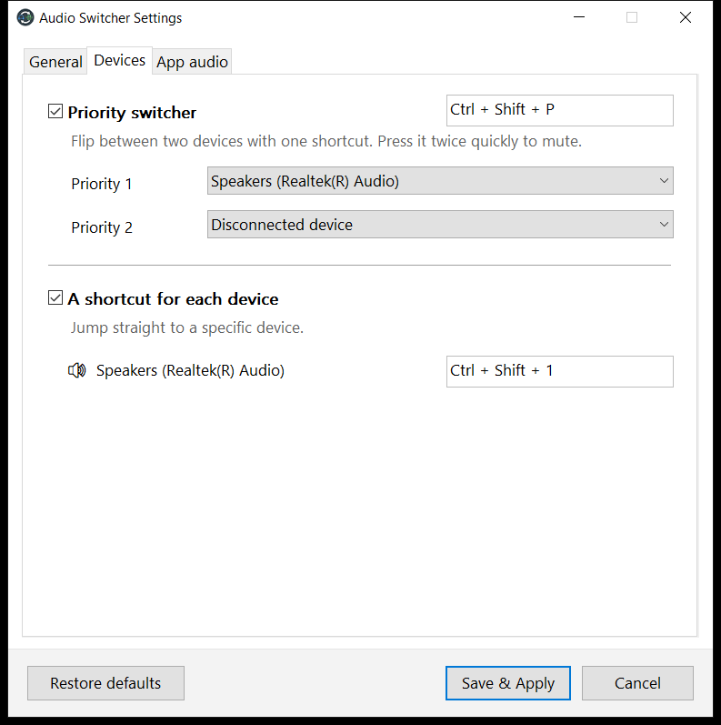
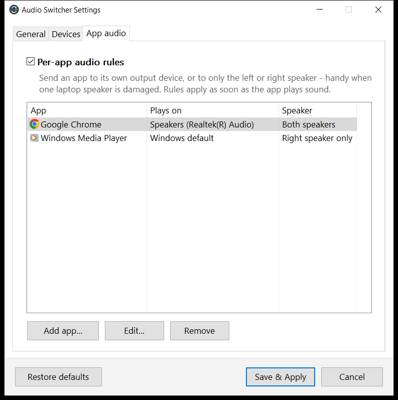
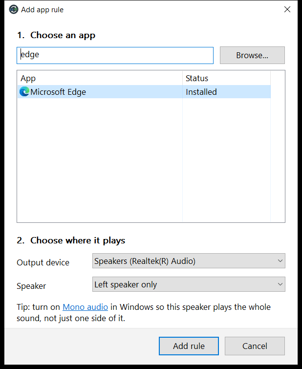
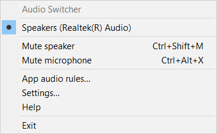
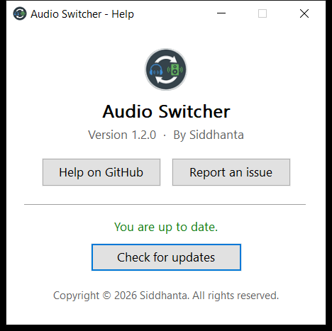

# Audio Switcher

**Switch speakers and headphones with one key - and give every app its own speaker.**

A tiny, fast system-tray app for Windows 10 and 11.

&nbsp;

&nbsp;

&nbsp;

[**Download the latest version**](https://github.com/Siddhanta-10/AudioSwitcher/releases/latest) ·
[Features](#features) ·
[How to use](#how-to-use) ·
[FAQ](#faq--troubleshooting) ·
[Report a problem](https://github.com/Siddhanta-10/AudioSwitcher/issues)

---

## What is it?

Audio Switcher lives in the notification area (next to the clock). It lets you:

- **Switch the sound output** - e.g. from speakers to headphones - with a keyboard shortcut or two clicks.
- **Mute** your speakers or microphone from anywhere with a shortcut.
- **Give each app its own speaker** - music in your headphones while games use the speakers, or
  play an app through **only the left or only the right speaker** (perfect for a laptop where one
  speaker is broken or crackles).

It has no ads, no account and no tracking, and it is lighter than a single web page:
about **260 KB** on disk and only a few MB of memory.

## Features

| | |
|---|---|
| 🔀 **One-key switching** | Flip between two favourite devices with one shortcut (*Priority switcher*), or give each device its own shortcut. |
| 🎚️ **Per-app audio** *(new in 1.2)* | Send any app to a specific output device and/or to the **left** or **right** speaker only. Rules apply automatically every time the app plays sound. |
| 🔇 **Global mute shortcuts** | Mute / unmute speakers and microphone from any app - even full-screen games. |
| 👆 **Double-press to mute** | Press the Priority shortcut twice quickly to mute instead of switching. |
| 🔔 **Notifications** | A small notification tells you which device is now active (can be turned off). |
| 🚀 **Start with Windows** | Optional, switchable at any time in Settings. |
| 🖥️ **Modern & sharp** | Crisp on every screen (per-monitor DPI aware), tray menu follows Windows' dark mode, full keyboard navigation. |
| 🔄 **Update check** | *Help → Check for updates* tells you when a new version is out. |
| 🔌 **Plug & play aware** | Notices when devices are plugged in or removed and keeps your settings for unplugged devices. |

## Screenshots

<table>
<tr>
<td></td>
<td></td>
</tr>
<tr>
<td></td>
<td align="center"></td>
</tr>
<tr>
<td align="center"></td>
<td align="center"></td>
</tr>
</table>

## Download & install

1. Go to the **[latest release](https://github.com/Siddhanta-10/AudioSwitcher/releases/latest)**.
2. Under **Assets**, download **`AudioSwitcherSetup-<version>.exe`**.
3. Run it and follow the steps. Windows asks for administrator permission once; Audio Switcher is
   installed to `C:\Program Files\Audio Switcher` for all users of the PC.
4. Audio Switcher starts and appears in the notification area. If you can't see it, click the **^**
   arrow next to the clock.

> **"Windows protected your PC"?** The installer is not code-signed yet, so Microsoft Defender
> SmartScreen may warn about it. Click **More info → Run anyway**.

**Requirements:** Windows 10 version 1803 or newer, or Windows 11 (64-bit). Nothing else - no .NET,
no Visual C++ runtime.

## Updating to the latest version

- In the app: right-click the tray icon → **Help** → **Check for updates**. If a new version exists,
  click **Get the update** to open the release page.
- Download the new `AudioSwitcherSetup-<version>.exe` from the
  [latest release](https://github.com/Siddhanta-10/AudioSwitcher/releases/latest) and run it.

If Audio Switcher is running, the setup tells you which version is installed and that it will close
it. It then updates the app in place and starts it again. **Your shortcuts and app rules are kept**,
and settings from older versions are upgraded automatically - there is nothing to re-save and no need
to uninstall first. (Updating from 1.1.x also works: the old version is removed automatically and its
settings are carried over.)

## How to use

Click (or right-click) the tray icon to open the menu:

- Click a **device** to make it the default output.
- **Mute speaker** / **Mute microphone** - the tick shows the current state.
- **App audio rules…**, **Settings…**, **Help**, **Exit**.

### Default shortcuts

| Action | Shortcut |
|---|---|
| Priority switcher (flip between two devices) | `Ctrl` + `Shift` + `P` |
| Priority switcher pressed twice quickly | mute / unmute speaker |
| Mute / unmute speaker | `Ctrl` + `Shift` + `M` |
| Mute / unmute microphone | `Ctrl` + `Alt` + `X` |
| Switch to device 1 / 2 / 3 *(when "A shortcut for each device" is on)* | `Ctrl` + `Shift` + `1` / `2` / `3` |

Change them in **Settings**: click a shortcut box and press the new keys. A shortcut uses **two
modifier keys plus a key** (for example `Ctrl` + `Alt` + `K`). Press `Backspace` to clear a box.
Settings warns you if two actions use the same keys.

### Per-app audio (give an app its own speaker)

1. Open the tray menu → **App audio rules…**
2. Click **Add app…** and pick the app. Apps that are playing sound are listed first; you can also
   search, or use **Browse…** to pick any `.exe`.
3. Choose where it should play:
   - **Output device** - e.g. *Headphones* (or keep *Windows default device*).
   - **Speaker** - *Both speakers*, *Left speaker only* or *Right speaker only*.
4. Click **Add rule**, then **Save & Apply**.

The rule applies straight away if the app is running, and automatically every time it starts
playing sound. Removing a rule gives the app its normal sound back (if the app is closed at that
moment, this happens the next time it plays sound).

> 💡 **Laptop with one broken speaker?** Set your apps to the working side, and also turn on
> **Mono audio** in Windows (*Settings → Accessibility → Audio*, or the link shown in the app).
> Mono audio mixes both stereo channels together, so the working speaker plays *everything*
> instead of only half of the stereo sound.

## FAQ & troubleshooting

<b>A shortcut does nothing / "Some shortcuts are unavailable"</b>

Another app already uses that key combination. Open **Settings** and choose different keys.

<b>An app keeps playing on the old device after I added a rule</b>

Most apps move instantly. A few older apps only pick up a new device when they restart - close
and reopen the app once.

<b>Per-app device is greyed out</b>

Moving single apps to another device needs Windows 10 version 1803 or newer. Speaker (left/right)
rules still work on older builds.

<b>How do I reset every app to the default device?</b>

Remove the rules in **App audio rules**, or use Windows' own reset button: *Settings → System → Sound →
Volume mixer* (Windows 11) or *App volume and device preferences* (Windows 10) → **Reset**.
Uninstalling Audio Switcher also resets the apps it changed.

<b>Where are my settings stored?</b>

In your Windows user profile (`%APPDATA%\AudioSwitcher`), so they survive updates and reinstalls.
If something goes wrong, zip that folder and attach it when you
[report a problem](https://github.com/Siddhanta-10/AudioSwitcher/issues) - it includes a small log.

<b>How do I uninstall?</b>

*Settings → Apps → Installed apps → Audio Switcher → Uninstall*. You'll be asked whether to keep
your settings (handy if you reinstall later).

<b>Does it collect any data?</b>

No. Audio Switcher never sends anything anywhere. The only network access is the update check,
and only when you click **Check for updates** (it asks GitHub for the latest version number).

## Changelog

### 1.2.0
- **New:** per-app audio rules - send any app to its own output device and/or only the left or
  right speaker.
- **New:** tabbed, modern Settings window; crisp on high-DPI and mixed-DPI screens.
- **New:** "Start with Windows" option in Settings; tray menu shows your shortcuts and follows
  Windows dark mode; left-click opens the menu too.
- **New:** starting the app again opens Settings instead of showing an error.
- Faster and lighter: ~40 % smaller exe, instant device-change detection, non-blocking update check.
- Settings survive updates and are upgraded automatically: new options get their defaults, existing
  ones are kept, and everything works without opening Settings first. Settings are saved crash-safely.
- Shortcuts for unplugged devices are kept; disconnected priority devices are no longer replaced.
- The tray icon comes back after Explorer restarts.
- Installer: true 64-bit install to `C:\Program Files`, warns when the app is running and restarts it
  after the update, removes 1.1.x automatically, and cleans up properly on uninstall.

### 1.1.1
- Previous release.

## License

Audio Switcher is free software, distributed under the
**GNU General Public License v3.0** (GPLv3). See [LICENSE](LICENSE) for the full text.

Copyright © 2026 Siddhanta.

## Author

**Siddhanta** · GitHub: [@Siddhanta-10](https://github.com/Siddhanta-10)
